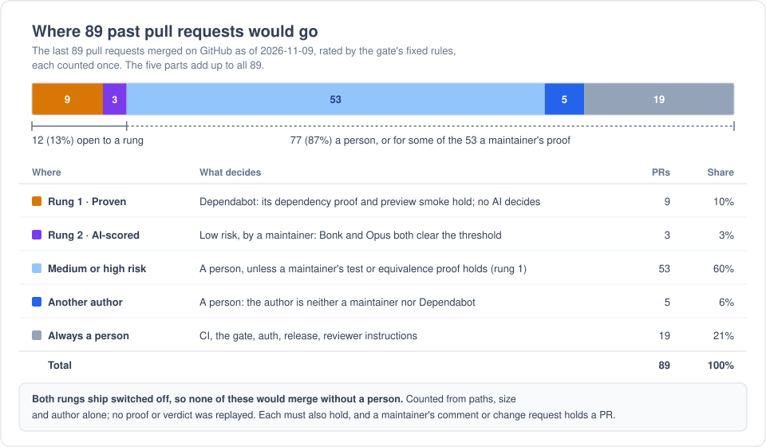
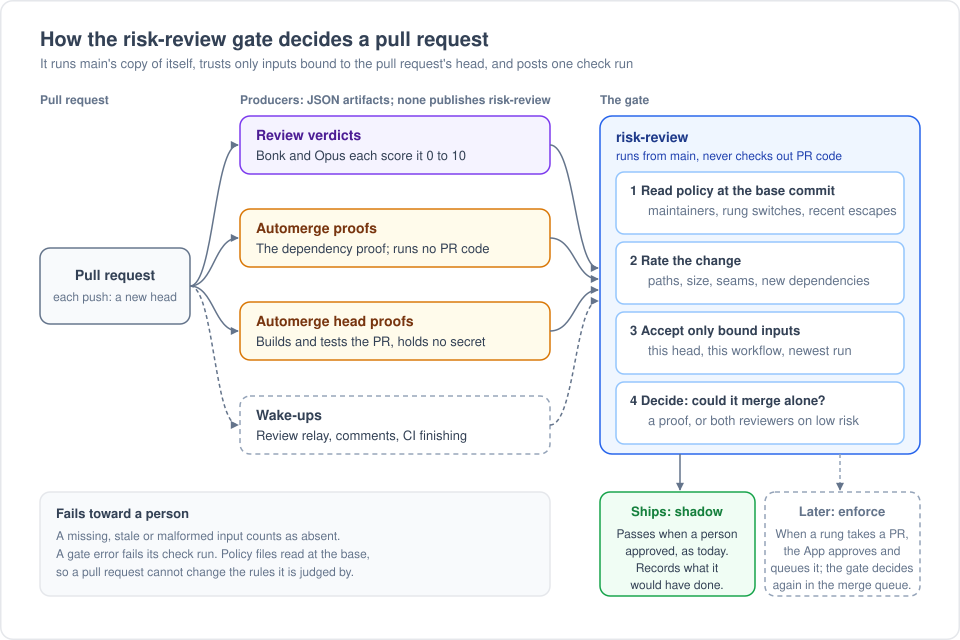

# Workflows

Notes on the workflows that need more than their own file to operate. Each file's header comment
is the design record; this covers what lives outside the repository.

## Preview deployments

[`preview.yml`](preview.yml) deploys a preview of each pull request from a branch in this
repository, on the Cloudflare account the `CLOUDFLARE_ACCOUNT_ID` variable names. It needs a
Cloudflare API token that can create Workers and storage, so it never runs for a pull request from a
fork: GitHub withholds secrets from those runs, and a maintainer deploys one when the change needs
manual review. The file's header explains why its triggers must stay as they are.

## Risk review

[`risk-review.yml`](risk-review.yml) posts the `risk-review` check run on each pull request into
`main` and on each merge group, as the risk-review GitHub App. It rates each change low, medium or
high risk and decides whether it could merge without a person; the rules are in
[`scripts/risk-review-policy.ts`](../../scripts/risk-review-policy.ts) and
[`scripts/risk-review.ts`](../../scripts/risk-review.ts). It reads three policy files from the base
commit: [`maintainers`](../maintainers), [`automerge.json`](../automerge.json) and
[`automerge-escape-files.json`](../automerge-escape-files.json).

A pull request needs a person when it touches a path that always needs one, may drop Durable Object
data, has an author who is neither a maintainer nor Dependabot, carries a maintainer's comment made
after its last push, or has a standing change request. Otherwise one of two rungs can take it, each
switched on in `automerge.json`:

- **Rung 1, proven.** A proof holds, whatever the risk level. A proof decides only a pull request
  whose every changed file it checks:
  - For Dependabot, `proof-deps` together with `preview-smoke`, on a pull request whose every
    commit is authored by `dependabot[bot]`, committed by `web-flow` and verified by GitHub.
    `proof-deps` checks `package.json` files, `pnpm-lock.yaml` and catalog version lines in
    `pnpm-workspace.yaml`, and fails when any other file changes.
  - For a maintainer, `proof-tests`, on a pull request that changes only test files vitest runs
    (`*.test.*` and `*.spec.*`) in one package. It holds when those tests still kill every mutant
    of the source they import that the base's version of them killed. It does not apply when any
    other file changes: source, a helper, a fixture or a document.
- **Rung 2, scored.** A maintainer wrote it, it is low risk, and both reviewers' verdicts are full
  reviews of this head with no P0 or P1 finding and no `NEEDS-A-PERSON`, name models from different
  providers, and give scores whose lower one is at least `threshold`. Medium and high risk never
  qualify.

It runs only from `main`'s definition, through `workflow_run` (when a producer workflow, CI or
the review relay finishes) and `issue_comment`, and never checks out or runs pull request code.
[`risk-review-trigger.yml`](risk-review-trigger.yml) only relays pull request, review and merge
group events to it; the gate decides a merge group only when the merge queue lists its commit.

Producer workflows (reviewer verdicts and rung 1 proofs) upload JSON artifacts, and none publishes
`risk-review`; Bonk also posts its review on the pull request. The two verdicts are Bonk's
(`bonk-pr.yml`, run "Bonk PR Review", artifact `automerge-verdict-bonk`) and our Opus runner's
(`review-verdict.yml`, `automerge-verdict-opus`);
the proofs come from `automerge-proofs.yml`, which runs no pull request code, and
`automerge-head-proofs.yml`, which builds and runs it and holds no secret. The gate
accepts an artifact only from a successful `pull_request` run of the expected workflow file on the
pull request's head commit and branch, in this repository, created after the pull request's base
last changed (and none counts until a push follows that change, since GitHub rebuilds the merge ref
in the background); and no run counts once another pull request from the same branch, open or
closed, has had another base at any point (read from its base-change history), since its runs use
that base's copy of the workflows. The run whose latest attempt started last wins even when it
failed. Dependabot pull requests get no deployed preview: their smoke runs in workerd, without
secrets, in Automerge head proofs. A rung 1 proof also counts only for the commit the pull request
would land on (its base, or the queue's commit under it in a merge group): `proof-deps` only while
the files it read at its base (`pnpm-workspace.yaml` and `pnpm-lock.yaml`) are the same readable
blobs there, and `proof-tests` only when made against that commit with a head that contains it. A
file with a recent escaped defect raises the risk level one step; that raise ignores lockfiles and
Markdown, `docs/` and `plans/` outside `.agents/`.

These paths always need a person:

- everything under `.github/`;
- gate and judge code: `scripts/risk-review*`, `scripts/automerge/`, `scripts/contribution-policy*`;
- every file an AI reviewer reads as instructions: any `AGENTS.md`, `CLAUDE.md`, `CONTEXT.md`,
  `REVIEW.md`, `CONTRIBUTING.md`, `opencode.json` or `opencode.jsonc`, and any file under a
  `.agents/`, `.opencode/` or `.claude/` directory, at any depth and in any letter case;
- auth config: `packages/workshop-backend/src/auth/`;
- supply-chain policy: any `.npmrc`, `.pnpmfile.cjs` or `.pnpmfile.mjs`, and `pnpm-workspace.yaml`
  beyond a catalog version bump;
- the release pipeline: `scripts/release/`;
- any Wrangler config other than the generated `wrangler.jsonc`: `wrangler.json`, `wrangler.toml`,
  `.wrangler/`.

The one exception is a skill's own files under `.agents/skills/` at the repository root: they are
not on this list. They are still instruction paths, so they rate at least medium risk, and no rung
takes a change to one today: rung 2 takes only low risk, and no rung 1 proof checks them. A symlink
there is on the list, and so is an instruction file or directory of its own inside a skill. Both
reviewers read the base commit's copy of every instruction path
([`scripts/automerge/instructions.ts`](../../scripts/automerge/instructions.ts) holds the one list
the reviewers and the gate use), so a pull request's edit to one cannot steer its own review.

A change that may drop Durable Object data always needs a person. The gate reads it from the
parsed `wrangler.jsonc`, the file Wrangler and the release manifest deploy from, and treats its
migrations as append-only: Wrangler finds the deployed migration by the first entry with its tag
and applies every entry after it, by position, so a list that is reordered, retagged, edited or
cut, or that uses a tag twice, can run an old deletion again. A person is needed when:

- the head's migrations do not start with the base's;
- an appended migration has no `tag`, or one its list already uses;
- an appended migration does anything but add classes (`deleted_classes`, `renamed_classes`,
  `transferred_classes`, an operation the gate does not know);
- the Worker's `name` changes;
- a `wrangler.jsonc` is removed or renamed, even to another directory;
- the file is not in the form the generator writes (`//` lines, then strict JSON);
- the change touches any other Wrangler config (`wrangler.json`, `wrangler.toml`, `.wrangler/`),
  which Wrangler would prefer or follow.

The gate does not read `cloudflare.config.ts`: it takes effect only through the generated file
(`pnpm configs:check`, part of `Lint`, fails while the two differ).

`automerge.json` sets the mode, the two rung switches, the `threshold` and whether the App's
approval counts. It ships in `shadow` with both rungs off, and a missing or malformed file means
the same. In shadow the check mirrors today's rule (`reviewDecision` is `APPROVED`), is not
required, and records the decision it would have made as JSON at the top of its output.
[`scripts/risk-review-report.ts`](../../scripts/risk-review-report.ts) prints a table from those
records: one row per merged pull request with its risk level, each reviewer's score and finding
counts, what the gate would have done, what people did, and the pull requests merged within 14 days
that revert it or name it. The team reads that table before it turns a rung on or lowers
`threshold`. In `enforce` mode the check reports the gate's own rule, and the App approves (when
`app_approvals_count` is true) and enqueues a pull request only when a rung takes it and it is not
a draft. A change to any of these files, or to anything else under `.github/`, always needs a
person.

### Setup

An organization owner, or a GitHub App manager, does this once.

1. **The app.** Create a GitHub App owned by the organization, with its webhook inactive, the
   repository permissions *Checks: Read and write*, *Pull requests: Read and write*, *Contents:
   Read*, *Actions: Read* (to read producer runs and artifacts) and *Merge queues: Read and write*
   (to enqueue), and installation limited to this account. Install it on this repository only. Set the repository
   variable `RISK_REVIEW_APP_ID` to its App ID.
2. **The key.** Generate a private key and store it as the secret `RISK_REVIEW_APP_PRIVATE_KEY` in
   the `risk-review` environment, with no reviewers and deployment branches limited to `main`. Do not
   add `gh-readonly-queue/main/*`: anyone who can push can create a branch with that name. Until the
   key exists the workflow fails at the token step and posts nothing; there is no fallback to the job
   token.

   **Never store the key as a repository secret.** A workflow a pull request adds can read those,
   and could then post a passing check run or an approval as the app.
3. **The `main` ruleset.** Leave it as it is in shadow mode, and do not require `risk-review`.
   Enforcing is a later team decision: require the `risk-review` check with the risk-review app as
   its source (GitHub needs a recent check run from the app to offer it), and add a merge queue.
   Before relying on App approvals, approve a real draft pull request as the App and confirm the
   ruleset counts it, then set `app_approvals_count`. Stale-approval dismissal is not needed: the
   gate counts only approvals of the head commit. Bonk need not become a required check: the gate
   reads both reviewers' verdicts itself, and rung 2 merges nothing unless both are present, `ok`,
   full reviews, free of P0 and P1 findings and `NEEDS-A-PERSON`, from models of different
   providers, and at or above the threshold. Rung 1 merges only on proofs.
4. **Actions settings.** Leave *Allow GitHub Actions to create and approve pull requests* off;
   otherwise a pull request's own workflow could approve it.

To rotate the key, generate a new one, replace the secret in the environment, then delete the old
key from the app.

### Known limits

- Bonk's verdict comes from a job that runs the pull request's code next to secrets, so it rests on
  a maintainer author and uncompromised dependencies. The Opus verdict, which no pull request code
  reaches, is required as well.
- The different-providers rule reads the provider from each verdict's `model`
  (`cloudflare-ai-gateway/<provider>/<model>`). It cannot tell that two providers serve one model
  family, so the choice of `BONK_MODEL` still needs that care.
- The producer binding rests on what GitHub records about a run (its head commit and branch, and
  when it was created) and on the pull requests' base histories. It is not a signed record of which
  workflow file ran. Artifact attestations (`actions/attest-build-provenance`, binding each result
  to `refs/pull/N/merge` and its merge commit) would be one; building them is a later decision.
- A newer Bonk run whose job was skipped (a label removed, a bot event) leaves Bonk's verdict absent
  until the next push, which sends the pull request to a person.
- The report lists a follow-up only when it names the pull request or reverts it within 14 days;
  fixes on GitLab, or ones that name nothing, are not listed.
