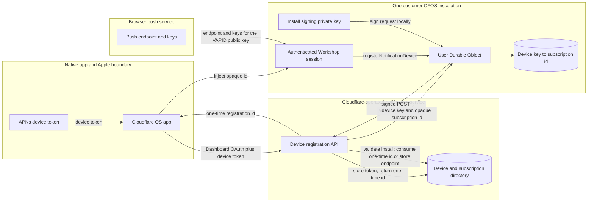
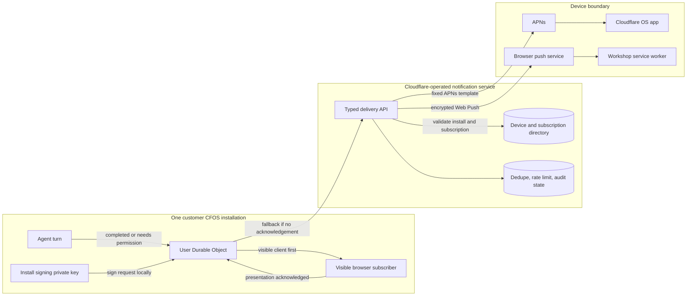

# Notifications architecture

Notifications are a platform feature, not a gatekeeper. The Workshop backend signs each request to
the Cloudflare-operated notification service with the installation's signing key. Each User
Durable Object stores one opaque subscription id per registered device, keyed by the
install-scoped device key the service returns with it, so a device that registers again replaces
its own subscription. The central service owns APNs and Web Push delivery and the
device/subscription directory, and accepts only fixed, typed notification templates. It does not
accept arbitrary notification text or any provider OAuth credential.

## Registration

Data boundaries:

- The APNs device token and Dashboard OAuth bearer never enter the customer installation.
- The install signing private key is a backend secret, held like `CF_AI_GATEWAY_API_TOKEN`; gadget
  and agent code run in isolates whose env never includes it.
- Workshop core stores only opaque central subscription ids, which are bound to the installation
  and useless without the install signing key, and the install-scoped device key each one reaches.
- A one-time device registration id is short-lived and cannot send a notification.
- A browser's Web Push endpoint and keys pass through the User DO to the service; the installation
  stores only the subscription id the service returns for them.

The native app hands the SPA a one-time registration id by setting
`window.__CLOUDFLARE_OS_NOTIFICATION_DEVICE_REGISTRATION__` before load or dispatching a
`cloudflare-os:notification-device-registration` `CustomEvent` with
`detail.deviceRegistrationId`. If none was injected, the SPA calls
`window.__CLOUDFLARE_OS_REQUEST_NOTIFICATION_DEVICE_REGISTRATION__()`, when present, once each
time the signed-in app mounts (a WebSocket reconnect does not remount it) to request one.
The SPA reports the outcome to `webkit.messageHandlers.cloudflareOSNotificationReady` as
`{type: "ready"}` or `{type: "failed"}`.

A desktop browser registers as a device too, with its Web Push subscription as the registration.
When the deployment advertises the service's VAPID public key (`ServerConfig.webPushPublicKey`), the
profile page offers a "Browser notifications" switch. Turning it on asks for permission, registers
`/sw.js`, subscribes with that key, and passes the endpoint and keys to `registerNotificationDevice`.
The service delivers to an endpoint only for its most recent registration, so when another account
in the same browser profile registers it, the previous account's subscription stops working. The
browser remembers which user it subscribed for: each sign-in registers that user's subscription
again, which renews it with the service, and unsubscribes one held for anyone else, so a different
user who signs in starts with browser notifications off and turns them on themselves; signing out
unsubscribes it at once, without waiting for a registration in flight. A subscription made with a
VAPID key the deployment no longer advertises is replaced with one for the current key before it
is registered again, including in an open tab when a reconnect brings a new key, so changing the
service's key costs no one their browser notifications; while permission stands, a subscription
the browser lost, or whose replacement failed, is made again at the next sign-in. Phones and
tablets never offer the switch, and neither does either native app, since the Cloudflare OS app
pushes there.

## Delivery

Only the event id, event type, task id (`<workspaceId>:<chatId>`), bounded chat title, opaque
subscription id, and same-origin deep-link path cross the central boundary during a send, plus the
headers every signed request carries: install id, key id, timestamp, nonce, body digest, and
signature. Permission details, chat content, gatekeeper grants, and provider credentials do not. A
visible browser tab is offered the notification first, and push is sent to every registered device
only if no tab acknowledges it within three seconds. A tab subscribes while visible, and again if a
User DO reset drops its subscription. When the service answers `device_gone` or
`invalid_subscription`, the User DO drops that subscription; the device subscribes again when its
app next opens. Any other failure, including `invalid_signature`, keeps it. Only turns a person
started announce completion; callback turns, such as a schedule, and spawned agents notify only
when they need the user's permission. A turn resumed by an approval or accepted connection keeps
its original initiator's model, account and notification recipient, as well as whether it was a
callback turn; the decision does not transfer ownership. Pauses created by older code have no
retained execution record, so their first decision instead adopts the deciding person's account
and notifications, matching the older behavior.
The deep link opens the chat with `showChat`, which leaves full-screen preview and switches a phone
showing the workspace's app to the chat. The service worker shows a browser's push even with every
Workshop tab closed; clicking it focuses the most recently used Workshop window and opens the chat
there, or opens a new window.

A user can mute a workspace, for a while or until they unmute it, from its menu in the sidebar, the
workspace list, or the editor's menu on a phone. The mute lives on that workspace's record in the
user's own User DO (`notificationMute`), so it applies only to them and is deleted with the record.
While it lasts, the User DO sends the workspace's finished tasks to no tab and no device. Permission
requests still come through, since a task waiting on the user stays stuck until they answer.

## Deployment contract

The trusted deploy service injects these into the backend; the private key is a secret:

- `NOTIFICATION_SERVICE_URL` (an `https:` origin; requests to any other are refused)
- `CFOS_INSTALL_ID`
- `CFOS_INSTALL_KEY_ID`
- `CFOS_INSTALL_PRIVATE_KEY` (base64 PKCS#8 P-256)
- `NOTIFICATION_WEB_PUSH_PUBLIC_KEY` (the service's VAPID public key, base64url)

Self-hosted deployments may omit them. In-tab notifications continue to work; native device
registration fails and the SPA reports `{type: "failed"}` to the app. Without
`NOTIFICATION_WEB_PUSH_PUBLIC_KEY` the browser notification switch is hidden.
