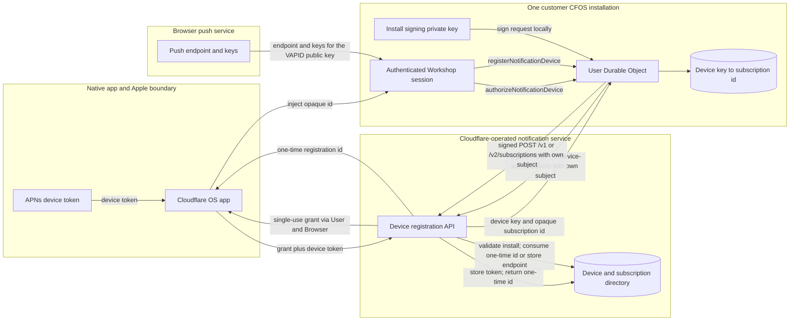
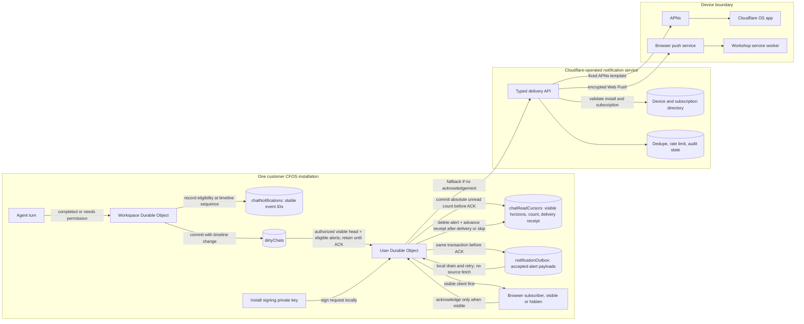

# Notifications architecture

Notifications are a platform feature, not a gatekeeper. The Workshop backend signs each request to
the Cloudflare-operated notification service with the installation's signing key. Each User
Durable Object stores one opaque subscription id per registered device, keyed by the
install-scoped device key the service returns with it, so a device that registers again replaces
its own subscription. The central service owns APNs and Web Push delivery and the
device/subscription directory, and accepts only fixed, typed notification templates. It does not
accept arbitrary notification text or any provider OAuth credential.

## Registration

Data boundaries:

- APNs/FCM tokens and native device-management credentials never enter the customer installation.
- A CFOS login is sufficient: the registered installation vouches for its authenticated User DO's
  opaque id. Every subscription is owned by `(install id, User DO id)`, not a Dashboard account,
  whether its destination is APNs, FCM, or Web Push.
- The install signing private key is a backend secret, held like `CF_AI_GATEWAY_API_TOKEN`; gadget
  and agent code run in isolates whose env never includes it.
- Workshop core stores only opaque central subscription ids, which are bound to the installation
  and useless without the install signing key, and the install-scoped device key each one reaches.
- A one-time device registration id is short-lived and cannot send a notification.
- A browser's Web Push endpoint and keys pass through the User DO to the service with that DO's
  opaque subject; the installation stores only the subscription id the service returns for them.

`authorizeNotificationDevice`, `registerNotificationDevice` and
`registerAuthorizedNotificationDevice` share one limit per User DO, native and browser alike: 20
calls per fixed minute-long window, which opens at the first call after the previous window ends.
The count is kept in memory, so a restarted User DO opens a new window early. Calls past 20 are
refused until the window ends, before anything is signed. Each admitted call sends a signed request
that touches records at the central service the whole installation shares, so one user's loop
could make them hot and use up the installation's request limit there, refusing every other user's
pushes until it resets.

The limit covers device calls only; deliveries aren't counted. A notification no open tab
acknowledges is signed once for each device the User DO stores, and it stores only a user's 10
most recently registered phones and, separately, their 10 most recently registered browsers, as
the service keeps that many of each. The User DO drops a device the service evicted only once a
push to it is answered `invalid_subscription` or `device_gone`, so without the cap a registration
loop could pile up devices for one notification to reach. It registers one device at a time, so
it stores them in the order the service received them.

The cap mirrors the service instead of asking it, so it can still drop a live device, which then
misses pushes until it next registers:

- A phone's place at the service is set when the phone itself registers there, before the
  installation exchanges that registration, so two phones registering at once can be ordered
  differently in the two places.
- A phone on the legacy path below counts toward its Cloudflare account's 10 at the service, so a
  user with legacy phones from several accounts can have more than 10 live.
- A device the service dropped for another reason, such as a revoked phone or a browser endpoint
  another user of the installation took over, still counts here until a push finds it dead.

Agreeing exactly would need the service to report a user's devices, which the protocol doesn't.

The legacy native path used by the currently distributed TestFlight build hands the SPA a one-time
registration id by setting
`window.__CLOUDFLARE_OS_NOTIFICATION_DEVICE_REGISTRATION__` before load or dispatching a
`cloudflare-os:notification-device-registration` `CustomEvent` with
`detail.deviceRegistrationId`. If none was injected, the SPA calls
`window.__CLOUDFLARE_OS_REQUEST_NOTIFICATION_DEVICE_REGISTRATION__()`, when present, once each
time the signed-in app mounts (a WebSocket reconnect does not remount it) to request one.
The SPA reports the outcome to `webkit.messageHandlers.cloudflareOSNotificationReady` as
`{type: "ready"}` or `{type: "failed"}`.

New native apps advertise `cloudflareOSNative.notifications.authorizationRequired`. Once the SPA
is authenticated, it calls `authorizeNotificationDevice()` and passes the returned single-use
ten-minute grant to `notifications.requestDeviceRegistration(grant)`. The backend derives the
subject from its User DO, never from a client-supplied email or account. Native sends the grant and
provider token directly to the central `/v2/devices` endpoint, keeps its per-install management
credential in secure storage, and exposes only the one-use registration to the SPA.
Native can request a replacement grant by dispatching the
`cloudflare-os:notification-authorization-request` event.
`registerAuthorizedNotificationDevice(id)` exchanges it with the same signed install/user scope.
CFOS logout first stops any grant or registration in flight, then calls
`notifications.disconnect()`; native revokes that install's device enrollment.
Provider-token refresh uses the native credential without a Dashboard login or web session.

Deploy central service, then CFOS backend/SPA, then native apps. Older native apps retain the
legacy Dashboard-authenticated v1 path and globals until upgraded. New native apps never fall back
to Dashboard authentication against old installations; the installation must be updated first.

A desktop browser registers as a device too, with its Web Push subscription as the registration.
When the deployment advertises the service's VAPID public key (`ServerConfig.webPushPublicKey`), the
profile page offers a "Browser notifications" switch. Turning it on asks for permission, registers
`/sw.js`, subscribes with that key, and passes the endpoint and keys to `registerNotificationDevice`.
The User DO derives the same opaque subject used for native registration and every delivery; the
subject records and enforces ownership but is not the endpoint's device key or the registry shard.
The service delivers to an endpoint only for its most recent registration, so when another account
in the same browser profile registers it, the previous account's subscription stops working. The
browser remembers which user it subscribed for: each sign-in registers that user's subscription
again, which renews it with the service, and unsubscribes one held for anyone else, so a different
user who signs in starts with browser notifications off and turns them on themselves; signing out
unsubscribes it at once, without waiting for a registration in flight. A subscription made with a
VAPID key the deployment no longer advertises is replaced with one for the current key before it
is registered again, including in an open tab when a reconnect brings a new key, so changing the
service's key costs no one their browser notifications; while permission stands, a subscription
the browser lost, or whose replacement failed, is made again at the next sign-in. Phones and
tablets never offer the switch, and neither does either native app, since the Cloudflare OS app
pushes there.

## Delivery

The workspace assigns persisted dense visible positions, so the User DO calculates counts by
subtraction rather than querying message history. The workspace checks admission before fanout;
denied fanout attempts skip that recipient, rather than parking work on the User DO. A settled
partial failure stores only failed recipients on the source dirty row; ACKed and denied users
are not retried. A crash before that checkpoint can replay the batch, with recipient deduplication
protecting accepted updates. Handoffs are bounded to two seconds. The all-success path writes no recipient checkpoint. Accepted alerts
retry from the user's durable queue with the same UUID after eviction or a lost ACK. The retained completed-delivery
receipt prevents re-enqueueing an already delivered alert on a source retry. Distinct alerts at
the same timeline position retain independent UUIDs and queue items. Revocation durably retries
recipient cleanup, which clears queued alerts and cancels in-flight delivery when received. See
[user-owned unread state](user-unread-state.md) for the handoff and deletion boundaries.

Only the event id, event type, task id (`<workspaceId>:<chatId>`), bounded chat title, opaque
subscription id, opaque User DO subject, and same-origin deep-link path cross the central boundary
during a send, plus the headers every signed request carries: install id, key id, timestamp, nonce,
body digest, and signature. Permission details, chat content, gatekeeper grants, and provider
credentials do not. A
visible browser tab is offered the notification first, and push is sent to every registered device
only if no tab acknowledges it within three seconds. Tabs retain their subscriptions while hidden,
but hidden clients reject `notify()` without presenting a toast, preserving push as the fallback.
A tab resubscribes if a User DO reset drops its subscription. When the service answers `device_gone` or
`invalid_subscription`, the User DO drops that subscription; the device subscribes again when its
app next opens. Any other failure, including `invalid_signature`, keeps the subscription and
retries only the failed device subscriptions for up to ten minutes from first acceptance.
Successful devices are not retried, and a failed event does not block later queued notifications.
Each attempt has a 15-second
budget, shortened to the remaining alert lifetime. Expired alerts are logged and discarded;
their fixed deadlines survive resets and are not extended by repeated source delivery. Later
alerts remain eligible, while unread counts are unchanged. Only turns a person
started announce completion; callback turns, such as a schedule, and spawned agents notify only
when they need the user's permission. A turn resumed by an approval or accepted connection keeps
its original initiator's model, account and notification recipient, as well as whether it was a
callback turn; the decision does not transfer ownership. Pauses created by older code have no
retained execution record, so their first decision instead adopts the deciding person's account
and notifications, matching the older behavior.
The deep link opens the chat with `showChat`, which leaves full-screen preview and switches a phone
showing the workspace's app to the chat. The service worker shows a browser's push even with every
Workshop tab closed; clicking it focuses the most recently used Workshop window and opens the chat
there, or opens a new window.

A user can mute a workspace, for a while or until they unmute it, from its menu in the sidebar, the
workspace list, or the editor's menu on a phone. The mute lives on that workspace's record in the
user's own User DO (`notificationMute`), so it applies only to them and is deleted with the record.
While it lasts, the User DO sends the workspace's finished tasks to no tab and no device. Permission
requests still come through, since a task waiting on the user stays stuck until they answer.

## Deployment contract

The trusted deploy service injects these into the backend; the private key is a secret:

- `NOTIFICATION_SERVICE_URL` (an `https:` origin; requests to any other are refused)
- `CFOS_INSTALL_ID`
- `CFOS_INSTALL_KEY_ID`
- `CFOS_INSTALL_PRIVATE_KEY` (base64 PKCS#8 P-256)
- `NOTIFICATION_WEB_PUSH_PUBLIC_KEY` (the service's VAPID public key, base64url)

Self-hosted deployments may omit them. In-tab notifications continue to work; native device
registration fails and the SPA reports `{type: "failed"}` to the app. Without
`NOTIFICATION_WEB_PUSH_PUBLIC_KEY` the browser notification switch is hidden.
