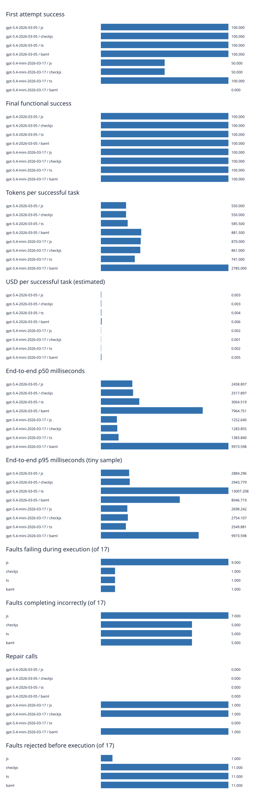

# Agent language benchmark results

Measured 27 October 2026 against Cloudflare OS `fd624bcdddbb071b1244edea055cb1c033f8ba80`. This is a working local experiment, not a production rollout or a completed statistical comparison.

**The evidence supports testing checkJs as an optional validation stage. It does not establish a model-reliability winner.** All three typed variants rejected 11 of 17 planted faults, versus 1 for syntax-only JavaScript. Each accepted and correctly executed all nine reference tasks. The corrected paid pilot stopped after 15 completed rows on an HTTP 503 with unknown billing; it is far too small to distinguish language familiarity from static guarantees.

## Deterministic findings

| Variant | Reference success | Rejected before execution | Failed during execution | Completed incorrectly |
|---|---:|---:|---:|---:|
| JavaScript | 9/9 | 1/17 | 9/17 | 7/17 |
| checkJs | 9/9 | 11/17 | 1/17 | 5/17 |
| Strict TypeScript | 9/9 | 11/17 | 1/17 | 5/17 |
| BAML v1 | 9/9 | 11/17 | 1/17 | 5/17 |

These are deliberately selected fault intentions, not estimates of error frequency in model output. Nine valid references are a limited false-rejection check, not a general soundness/completeness result. No previous benchmark archive was attached: the earlier 1/17 and 10/17 claims were not reproduced against identical fixtures. This suite independently produces 1/17 and 11/17.

Raw rows separate incorrect results from claims of success despite incorrect results; the table combines those two categories. JavaScript success claims are observed through `self.report("success")`. The BAML counterpart of that fixture returns a closed status without the same report callback, so its claim behavior is not equivalent. Authorization tests use the host's scoped mock service. Denied unauthorized writes are not evidence of language safety.

Tasks cover aggregation, nested typed lookup, unfamiliar tools, recovery, concurrent state, workflow effects, date boundaries, unauthorized writes and false success. State, capability checks and the oracle live outside the candidate isolate. Required tool traces prevent programs from passing solely by returning a memorized answer. BAML exposes equivalent logical tools through host callbacks; nullable optional fields normalize to omission. A bridge limitation requires a response envelope for typed arrays. These adapters and the restricted checkJs entrypoint shape remain engineering limitations.

## Corrected model pilot

Both tiers used pinned model versions, low reasoning, standard service tier, 8192 maximum output tokens and at most two repairs. Initial JavaScript is shared by JS/checkJs. TS and BAML are independently generated; language documentation is supplied without reference solutions. The pilot reached only aggregate and typed-list tasks, with one or two observations per model/variant. There are no completed repeated trials per task/model/variant.

| Model | Variant | n | First success | Final success | Tokens/success | USD/success | p50/p95 ms | Repairs |
|---|---|---:|---:|---:|---:|---:|---:|---:|
| gpt-5.4-2026-03-05 | js | 2 | 2/2 | 2/2 | 550.0 | $0.003412 | 2459/2884 | 0 |
| gpt-5.4-2026-03-05 | checkjs | 2 | 2/2 | 2/2 | 550.0 | $0.003412 | 2518/2944 | 0 |
| gpt-5.4-2026-03-05 | ts | 2 | 2/2 | 2/2 | 585.5 | $0.003945 | 3005/13007 | 0 |
| gpt-5.4-2026-03-05 | baml | 2 | 2/2 | 2/2 | 881.5 | $0.006148 | 7965/8047 | 0 |
| gpt-5.4-mini-2026-03-17 | js | 2 | 1/2 | 2/2 | 870.0 | $0.001526 | 1253/2698 | 1 |
| gpt-5.4-mini-2026-03-17 | checkjs | 2 | 1/2 | 2/2 | 861.0 | $0.001486 | 1284/2754 | 1 |
| gpt-5.4-mini-2026-03-17 | ts | 2 | 2/2 | 2/2 | 741.0 | $0.001883 | 1384/2550 | 0 |
| gpt-5.4-mini-2026-03-17 | baml | 1 | 0/1 | 1/1 | 2785.0 | $0.004549 | 9974/9974 | 1 |

Final-success Wilson 95% intervals are 34.2–100% for 2/2 and 20.7–100% for 1/1. Even these are merely descriptive pooled intervals across heterogeneous tasks. The one-observation BAML mini row is not comparable to two-task rows. The small model's initial aggregate semantic error passed both JS and checkJs validation; repair corrected it. Its BAML aggregate required one compiler-guided repair. None of this establishes a population-level advantage.

Reported arm costs include the shared first generation in each hypothetical arm, while the actual provider ledger counts it once. Tokens include task, language documentation, diagnostics and output; separate prompt/documentation estimates and provider usage are retained in raw calls. p95 with one or two observations is just the maximum observed value, not a stable latency percentile.

## Local performance

| Stage | Fresh process / first request | Warm process / subsequent requests |
|---|---:|---:|
| JS syntax validation | 77.82 ms median, n=5 | 24.71 ms median, n=30 |
| checkJs validation | 193.63 ms median, n=5 | 56.24 ms median, n=30 |
| Strict TS validation | 193.49 ms median, n=5 | 50.98 ms median, n=30 |
| JS workerd aggregate request | 77.41 ms, n=1 | 1.38–2.41 ms, n=5 |
| BAML workerd aggregate request | 3892.37 ms, n=1 | 3122.44–3332.56 ms, n=5 |

The TypeScript compiler creates a fresh Program each time; “warm” means process/JIT/OS caches, not incremental checking. BAML reinitializes and compiles source on each request in the reused isolate. These timings do not measure precompiled BAML SDK calls. Use external request timings: workerd's restricted internal clock is unsuitable for fine-grained compiler measurements. Development activity overlapped some timing collection. No production latency, compute-billing or concurrency scaling claim follows from this microbenchmark.

## Costs and stop condition

The initial pilot was invalidated by unequal callback exposure, an ambiguous BAML signature and incomplete tool-use checks. Its evidence remains under `pilot-superseded` and is excluded from reliability comparisons. Estimated known usage cost: $0.151535, with $0.128990 reserved for an interrupted request whose charge is unknown.

The corrected pilot recorded $0.03949525 known estimated usage and $0.03935925 reserved for its HTTP 503 request. **Combined known estimate: $0.19103025; unresolved reservations: $0.16834925; conservative usage-plus-reservation bound: $0.35937950.** These are not settled invoices. No OpenRouter inference was run after its negative-credit preflight. Runtime compute costs were not measured. The $10 per-invocation inference cap was not reached; unknown billing triggered the mandatory stop. Do not restart a new ledger until account billing is reconciled.

## Verification and provenance

- Final deterministic batch: 104 rows (36 references and 68 fault cases).
- Workshop evaluations: 129 tests passed across 16 files, including compiler, workerd/BAML, oracle, MCP schema and repair tests.
- MCP shared suite: 324 tests passed across 22 files.
- Repository `pnpm lint`: 84/84 tasks successful; existing warnings remain.
- Compiler API: TypeScript 5.9.3; BAML runtime: `@boundaryml/baml-bridge-web@0.23.0`; Miniflare: 5.20261001.0-alpha. Lockfile pins dependencies.
- BAML source inspected: `3d20df898fbea29e24be06222aeee25ad48f8597`; native CLI installed/probed: `0.23.1-nightly.20261026.a`. Execution measurements use the web bridge, not that native CLI and not BAML v0.

Final deterministic evidence includes optional-field normalization and the revised counter oracle permitting valid serial read/write. Those changes do not affect the completed corrected pilot's aggregate/typed-list tasks. Source hashes mark task files at run start; subsequent formatting can change those hashes. Exact candidate programs and diagnostics are preserved in every attempt. Superseded development runs and the original dry-run prompt inventory are clearly labeled in the [evidence inventory](agent-language-data/README.md).

## Reproduction and remaining work

See [runner instructions](../../packages/workshop-evals/src/agent-language/README.md) for deterministic, performance, dry-run, summary and opt-in paid commands. Install the lockfile dependencies; no BAML native installation or model credential is required for deterministic execution. [JSON summary](agent-language-data/summary.json), [CSV summary](agent-language-data/summary.csv), [fault CSV](agent-language-data/deterministic.csv), raw JSONL and [performance samples](agent-language-data/performance.json) are committed.

Not executed: a 30-trial campaign, full task coverage with either model tier, production Dynamic Worker loader/Gatekeeper integration, incident-desk end-to-end comparison, compiler placement in deployed Workers, incremental TypeScript checking, full Cap'n Web type coverage, malformed-response/cancellation soak tests, deterministic repair as a measured arm, or hybrid fixed-BAML-function inference. Local workerd success does not establish production upload-size or runtime-limit compatibility. The roughly 14 MiB BAML WASM payload needs deployment investigation.

## Decision

Keep production Code Mode unchanged while evaluating an opt-in checkJs validation stage. It caught the same selected faults as strict TS and BAML, preserved the generated JavaScript execution bytes, and added tens of milliseconds in the warm local probe. This is evidence of validation feasibility, not demonstrated improvement in total model task completion or cost.

Switching the generated language to strict TS currently has no measured reliability benefit over checkJs. BAML dynamically compiled and executed real v1 programs in local workerd, but bridge adaptations and multi-second dynamic compilation make general Code Mode integration premature. BAML remains plausible for selected fixed typed LLM functions, where compilation can be amortized and structured parsing/client features matter; this experiment did not measure that use case's quality or cost.

Next: reconcile the two uncertain provider charges; freeze the corrected protocol; run a complete small pilot across all nine tasks and both tiers; then allocate a bounded 30-trial campaign to promising arms. Separately test incremental checkJs and production-compatible compiler placement with real generated capability declarations. Require final functional success and total cost/latency evidence before adopting any replacement language. See [architecture and language analysis](agent-language-comparison.md).
