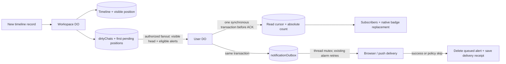

# User-owned unread state

The workspace owns the timeline and message ordering. Each User DO owns its user's private read
horizons, unread counts and outbound alert queue. No read receipts are exposed to other users. See [the UI consumers](user-unread-ui.md)
for inbox, viewport and native bridge behavior.

Chats created by `spawn()` or `spawnCallable()` default to muted badges and alerts,
including permission alerts. Normal chats default to enabled. Each user can change either kind
with the thread menu's **Mute notifications** / **Unmute notifications** control. The User DO
stores the override on its private read cursor; source fanout carries the default from persisted
`spawnerName`, without overriding the user's choice. Muting clears queued alerts and excludes the
chat from badge rollups, without advancing its read horizon or clearing its unread count. Muted
chats keep their catch-up divider, ordinary reading receipts and explicit read/unread actions.
The unread inbox still includes them, with no badge. Changing the preference consumes known
alert positions, so enabling only alerts about future activity while preserving unread history.
The upgrade journals existing spawned chats through ordinary durable fanout to apply the default.

## Visible positions, not timeline scans

Raw `sequence` still identifies every timeline record, including tools and reasoning. Every newly
written record also stores `visibleThroughSequence`: the number of visible messages through that
record. Only nonempty text or attachments count; generated slash-command expansions do not.
Non-visible records carry the current prefix without incrementing it. Existing record updates
preserve their prefix. Visible messages are append-only; deletion removes the whole thread and
its counts rather than renumbering history.

The workspace extends its existing `nextChatSequences` row with the visible counter, first
tracked raw position and latest visible message's raw position. That last pointer lets fanout read
the latest preview/time by key without scanning past internal activity. The counter, stamped record and dirty marker commit synchronously through
the typed-storage write transaction. Raw sequence allocation preserves the visible counter.
Fanout carries an absolute visible head, so duplicate/older deliveries never increment counts.

There is **no historical backfill**, workspace enumeration or rollout-time recipient RPC. Old
records remain unnumbered and are treated as already read. If the first delivered visible message
is 4, the User DO initializes its read-visible horizon to 3. For a coalesced first batch 4..6,
the source's durable dirty row retains 4 and the resulting unread count is 3. Metadata-only updates
do not initialize missing cursors. An explicit “mark unread” in unnumbered history counts only
newly numbered messages, not that history.

## User storage and local reads

Each `chatReadCursors` row contains:

- `workspaceId`, `chatId`
- `readThroughSequence`: inclusive raw UI horizon, -1 means before the timeline
- `readThroughVisibleSequence`: corresponding dense visible horizon, initialized immediately before the first delivered visible position
- `latestVisibleSequence`: latest accepted visible head, monotonic
- `unreadCount`: `latestVisibleSequence - readThroughVisibleSequence`
- `notificationsEnabled`: optional explicit per-user override
- `notificationsMutedByDefault`: source default for spawned chats
- `notifiedThroughSequence`: completed-alert deduplication receipt, in raw coordinates
- `notifiedEventIds`: completed alert UUIDs at that position; absent when admission skips the whole position
- `head`: copied thread title, latest visible raw position, bounded one-line preview and activity time
- `headUpdatedAt`: the workspace metadata's existing monotonic `lastActive`, ordering titles at the same message position
- `deleted`, only on a deleted thread's tombstone

`notificationOutbox` contains the accepted alerts themselves: stable UUID, kind, bounded chat
title, workspace/thread IDs and raw sequence. It is keyed by workspace, chat, raw sequence and UUID,
so two independent alerts at the same timeline position remain separate work items.
The queue is the work record: there is no User DO notification dirty bit, history-fetch cursor,
denial flag, new timer or notification backfill process.

Counts and queue headers hydrate from local storage once per User DO lifetime. Snapshot reads
and subscriptions use that memory, never list threads on other DOs, and never write read rows.
The existing source fanout carries inbox metadata with the count; title changes already dirty the
same thread and use the same retry path. Metadata-only updates don't initialize a missing cursor or
change read horizons, including on preference-only rows whose read tracking has not started.
Preference changes accept only the source default and alert receipt, leaving the read positions,
count and paired inbox head to ordinary fanout. The existing admission callback can repair metadata
skipped during denied admission, using `headUpdatedAt` to reject older captured titles without a source read or new counter.
Every live tracked cursor stores a head and both visible positions, supplied by message fanout,
first admission or an open-session read command. Tombstones and preference-only rows may omit a
head. Bulk actions rely on this invariant; there is no metadata lookup fallback.

Three targeted local queries avoid transferring the full thread state for every consumer:

- `getUnreadThreads()` returns only unread rows, including display metadata, newest first.
- `getWorkspaceUnreadState(workspaceId)` returns tracked thread horizons/counts for that workspace,
  including read rows, to merge into the Workspace DO's ordinary thread list. Missing rows are read.
- `getUnreadSummary()` returns badge totals and nonzero per-workspace rollups, excluding muted chats
  and without thread rows. Per-chat queries still return actual unread counts for muted chats.

All three use hydrated local rows, write nothing, and query no other DO.
`subscribeToUnreadState(scope, subscriber)` requires an explicit scope: `"summary"` sends no
thread rows, `"unread"` sends only unread rows, and `{workspaceId}` sends read/unread statuses only
for that workspace. Every scope includes global and per-workspace badge rollups. In-scope changes
send one thread delta (null removes a now-read inbox row); out-of-scope changes send only rollups.
Each delta carries just the changed workspace's rollup and global totals, not every workspace.
Bulk replacements and reconnects retain the same scope, never the full historical thread list.
The web app uses one subscription, switching its scope with the active view. The inbox refreshes
its targeted local query on those updates, including title-only updates. Ordinary workspace thread lists retain their existing open-session query path.
Native badge replacement uses the existing
versioned `notificationBadge` scalar outbox; its version is not a read-state/source version.

## Handoff, retries and eviction

1. The workspace commits the new record, visible counter and `dirtyChats` marker. Its existing
   shared alarm is armed before async dispatch. The marker retains the earliest pending raw event
   and first visible position, including through coalescing and resets.
2. The workspace reads inbox metadata and pending eligibility records once per batch and checks current build
   membership plus previously established observer admission locally. It sends authorized packets
   to the owner and established collaborators in parallel; independent threads also fan out in
   parallel. Each User DO handoff has a two-second limit. It does not enroll observers or call
   external gatekeeper verifiers per message.
3. A listed User DO synchronously commits the absolute head/count and any new queued alerts in
   one transaction. Queue insertion is deduplicated by event UUID and the completed-delivery
   receipt. It arms the existing alarm before ACK. Slow browser/provider delivery does not hold
   up that ACK or later count updates.
4. If everyone ACKs or is intentionally skipped, the workspace clears the marker without writing
   recipient bookkeeping. Otherwise it writes only `failedRecipients` on that same row. Each entry
   keeps its earliest pending raw/visible positions; `retryOnly` means no new broadcast remains.
   Subsequent attempts target only those failures, rechecking current admission. An unchanged
   repeated failure needs no row rewrite. New mutations still broadcast to everyone, retaining
   older work only for failed recipients. Mutations during an await become the next broadcast,
   without being erased by the older pass's checkpoint or delayed by its retry backoff.
5. The User DO drains each chat's local queue under its existing per-thread mutex. A failed
   attempt stores only its failed subscription IDs on that queue item; later events still run.
   Arrivals attempt fresh events, while alarm/restart recovery retries failed destinations without
   re-offering them to browsers or successful devices. Completion, intentional skip or expiry
   atomically deletes the item and advances `notifiedThroughSequence` plus the UUIDs completed at
   that position. Older failed items remain queued even when a later event advances the receipt.

If a caught-up user receives exactly their own next visible message, the User DO advances both
read horizons with the head and keeps the count zero. When already behind, or when a batch spans
multiple new messages, ordinary subtraction applies: there is no provenance scan across a gap.

Each queued alert has a fixed ten-minute expiry recorded at first acceptance. Replays and DO
resets preserve that deadline. Failed delivery uses the existing 30-second alarm retry; each
attempt is bounded to 15 seconds or the remaining lifetime, including browser acknowledgement
and push. Expiry intentionally drops the alert, logs `notification.delivery.expired` without
notification contents, and advances the same delivery receipt so the source cannot replay it.
Later queued alerts proceed independently of earlier failures. Counts and read horizons are
unaffected by delivery expiry.

Count arithmetic needs no source RPC. Notification delivery/recovery also performs **no workspace
read**. The sole queued payload is sufficient to retry after eviction. A new DO lifetime reloads
queue headers, preserves an existing alarm and resumes pending delivery; unrelated activity must
not postpone an outstanding retry deadline. In-memory promises/locks only serialize live work.

The completed-delivery receipt is retained solely for source retry deduplication: once a delivered
item is deleted, the queue alone cannot distinguish a lost source ACK from a brand-new alert.
It is not used to fetch notification history. Source eligibility records keep the original UUID
so recovery of the same agent outcome does not manufacture another notification.

This is not exactly-once OS alert delivery. A reset/lost provider ACK can retry the same stable
UUID after the provider effect but before local checkpoint. The central service's existing
reservation/deduplication policy governs that ambiguity.

Source fanout also remains at least once: a crash before recording failures/clearing the marker
can replay that batch to recipients that already ACKed (or were denied). This is the accepted
optimization boundary: there are no pre-dispatch/per-success recipient writes. Recipient counts,
queue keys and completed-delivery receipts deduplicate repeated accepted updates. Once a pass
checkpoints, ACKed/denied recipients are absent from its retry list, including across eviction.

## Explicit read commands

The UI retains raw timeline coordinates. Individual read/unread commands are methods on the
already-authorized `Overseer` session. The Workspace DO translates the boundary with one local
reverse indexed seek (`end`, `reverse: true`, `limit: 1`), then sends the paired raw/visible
horizon, latest visible position and head to `UserDurableObject.applyReadHorizon`. A future raw
position is rejected; a non-visible record or gap maps to its preceding visible prefix. Omitting
the boundary uses the latest visible message, so thread menus need no metadata fetch.
Use-only sessions deny these commands. No separate caller-supplied identity authorization path exists.

The User DO applies this packet synchronously using only local rows, without waiting for
notification delivery. It preserves newer heads and own-message read advances received before the packet is processed,
unless the command explicitly rewinds. It commits changed horizons/counts and publishes updates;
identical state causes no write. Read commands never drain queued alerts, so a delivery failure
cannot reject a successfully committed read. Alert delivery retains its own mutexed processing.

`AuthenticatedApi.markWorkspaceRead(workspaceId)` and `markAllRead()` operate entirely in the
User DO. They advance each tracked unread row to its locally received head and visible position,
without waking a workspace or fetching its newer tail. Messages arriving afterward remain unread.
Read commands leave notification receipts and queued alerts unchanged.

There are no read receipt tokens or versions. In-workspace commands use the ordinary session
failure/reopen behavior; local bulk commands retain the API's existing one-time reset retry.
Processing order, including retries, determines the result of conflicting actions. There is no
new operation journal, lifecycle or retry protocol.

**Acceptance criterion:** no unread-related User DO operation accesses a Workspace DO. Message
processing, notification recovery, queries, subscriptions and bulk commands are local; individual
read commands enter through an open workspace and push their translated result to the User DO.
The removed `getChatHeads`, `getChatHeadsForUser`, `getChatReadPositionForUser` and authenticated
raw-receipt command APIs must not be reintroduced as fallback paths.

## Authorization and lifecycle

The **Workspace DO** decides whether it may fan out to a user. Confirmed admission denial skips
those alerts; it is not work parked on the User DO and does not create polling. A later authorized
sequence (or the existing authorized-open callback) catches established unread counts up. A new
batch does not fetch skipped alerts. Badge reads use last-known local access, not renewed admission checks.

After a pass checkpoints, denied recipients are not retained for retry; another user's failure
cannot revisit them after re-authorization. The exception is the accepted source-reset window
before that checkpoint described above. No separate skip receipt or per-user denial flag is stored.

Once accepted, a queued alert is authorized durable delivery intent and retries locally. Existing
revocation, downgrade, dismissal and workspace-removal callbacks clear the listing's cursors and
queued alerts. Revocation updates are journaled on the source before restarting live sessions;
the existing alarm retries failed callbacks in parallel with the same two-second handoff limit.
Each retry checks current membership, so restored build access supersedes an obsolete removal.
Listing lifetime identity fences in-flight read/delivery responses after removal and readmission.
Removal aborts in-flight push requests and prevents browser-to-push fallback. Already dispatched
browser/provider effects cannot be recalled.

Thread deletion clears its count and queued alerts but retains a small `deleted` marker in its
cursor row. Thread IDs are never reused, so even after eviction a delayed pre-deletion packet
cannot recreate work. Workspace deletion immediately marks the source inaccessible, journals all
removal callbacks and sends them in parallel. Failed recipients remain on that same retry list;
storage is retained until every callback ACKs, then physically wiped. A reset after the last ACK
still resumes that wipe. No recipient fetches the source during removal.

Successful first admission seeds the captured existing tails as read. Ordinary reopen does not
initialize missing or preference-only cursors or consume pending new-thread arrivals. Initial join
remains the existing best-effort flow: events racing the registration callback need not be covered. Once
registration completes, new events follow the durable handoff above. There is no extra enrollment
catch-up RPC or background admission lifecycle.

## Consumers and verification

Notification policy remains task completion and permission requests, not an alert for every
visible message. Workspace mutes still suppress completion alerts only; chat mutes suppress all alerts and badges. Browser acknowledgement and native fallback are unchanged; see
[notifications](notifications.md). Native/push badge consumers are added by the
[stacked consumer PR](https://github.com/cloudflare/cloudflare-os/pull/842).

`packages/workshop-backend/__tests__/unread-state.test.ts` covers dense positions, no historical
backfill, local hydration/no-op reads, read/arrival races, deltas, real source and User DO resets,
lost ACKs on both handoffs, stalled delivery, ordered outbox checkpointing, denied admission,
failure-only retries across eviction, common-path write counts, concurrent broadcasts,
revocation and durable deletion tombstones. `notifications.test.ts` covers service signing,
notification policy and device subscription replacement. The real WebSocket API, devices, collaborators,
partial reads and deletion are covered by
`packages/integration-tests/__tests__/workshop-unread.test.ts`.
