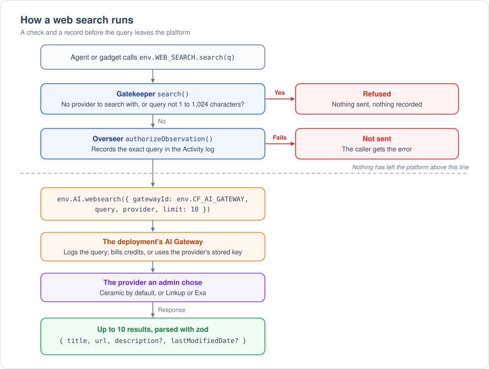
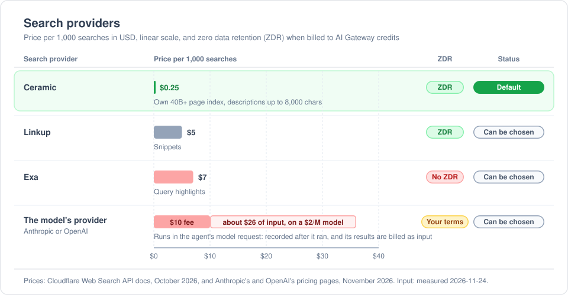

# Web Search

Web Search is an ambient gatekeeper that lets the agent and gadgets search the public web. A
deployment admin chooses where searches run (see [Providers](#providers)): by default on
Cloudflare's [Web Search API](https://developers.cloudflare.com/web-search/), with Ceramic. It
has no connect flow, no user settings and no management UI.

## Who gets it

The admin Gatekeepers panel sets the mode, like every auto-provisioned gatekeeper
(`provisioning-policy.ts` in workshop-backend):

- **Optional** (the default): onboarding offers it switched on, and a user can turn it on or off
  later on the Gatekeepers page.
- **Enabled**: every user gets it.
- **Disabled**: no one gets it, and existing accounts go dormant.

A user who has it gets a `WEB_SEARCH` binding in the agent's `executeCode`, in every workspace. The
agent can bind it into a gadget with `setGadgetBinding`. The binding appears when the workspace
next opens, from the next turn of each chat, including chats that started before. The agent is
told about it in that chat; the system prompt doesn't change. A spawned agent's chat keeps the
bindings its spawner gave it.

The binding is also what lets a chat search in its model, where the admin chose the model's
provider. So the mode and a user's own choice cover both ways to search.

A change of mode, or a user turning it off, also takes effect when each workspace next opens. Until
then, its open chats and scheduled gadgets can still search. Uninstalling the Worker stops every
search at once, in a model too.

## Agent API

The binding exposes `WebSearchSession`. The contract lives in [`src/types.d.ts`](src/types.d.ts).

```js
export default async function(self, env) {
  const results = await env.WEB_SEARCH.search("durable objects alarms");
  // [{ title, url, description?, lastModifiedDate? }, ...]
}
```

`query` is 1 to 1,024 characters, the API's limits. The caller picks no provider and no result
count, and gets up to 10 results.

Ceramic, the default provider, matches keywords, not meaning. So `types.d.ts` tells the agent to
send a few specific keywords rather than a question, as
[Ceramic's agent skill](https://docs.ceramic.ai/api/search/agent-skill) advises. In our blind test
of 36 questions, two graders scored Ceramic's results about 0.4 points higher out of 4 for queries
written this way than for the queries a model wrote without the guidance.

## How a search runs

<p align="center"></p>

For each search, the session reads the admin's stored choices with
`ApprovalQueue.getAdminSettings()`. Then `src/search.ts` does the work:

1. It refuses if there is no provider to search with: the admin chose the model's provider and
   no fallback, or a stored choice is one this version does not offer. Nothing is sent or
   recorded.
2. It refuses a query outside 1 to 1,024 characters. Nothing is sent or recorded.
3. It records the query through the session's `ApprovalQueue`. The query goes in a literal field,
   built with gatekeeper-kit's `buildDescription`, so the record shows exactly what was sent. The
   record names the provider that receives the query. If the record is refused or fails, nothing
   is sent.
4. It calls `env.AI.websearch({ gatewayId: env.CF_AI_GATEWAY ?? "default", query, provider, limit: 10 })`.
5. It parses the response with zod, which drops the image and favicon fields. A failed search
   throws `Web search failed with HTTP <status>.` without the provider's body, which can quote the
   query back. The record stays, and no other provider is tried.

## Providers

An admin chooses under Admin → Gatekeepers → Web Search → **Search provider**. The choice
applies to every search, in every workspace, open ones included. A change reaches a search within
about a minute: a session reads the choice from the Workshop's KV copy of the admin settings.

| Search provider | A search runs | Per 1,000 searches | Zero data retention |
|---|---|---|---|
| Ceramic, the default | On Cloudflare's Web Search API | $0.25 | When billed to credits |
| Linkup | On Cloudflare's Web Search API | $5 | Yes |
| Exa | On Cloudflare's Web Search API | $7 | Not when billed to credits |
| The model's provider | In the agent's model request, with Anthropic's or OpenAI's own search tool | $10, plus the results as input tokens: about $26 more on a $2 per million model | Only by the operator's agreement with the provider |

Prices: Cloudflare's Web Search API docs, October 2026, and Anthropic's and OpenAI's pricing
pages, read 2026-11-23. The input tokens were measured on `claude-haiku-5-5` on 2026-11-24.

<p align="center"></p>

### The model's provider

With this choice, the agent's model searches with its provider's own tool, inside the model
request. The Workshop does that, and this gatekeeper takes no part in such a search
([`plans/built-in-web-search.md`](../../plans/built-in-web-search.md) is the design record):

- It applies to every Anthropic and OpenAI model the deployment runs on AI Gateway, at once. No
  model has a search setting of its own.
- A chat gets the tool only while it holds the `WEB_SEARCH` binding and its workspace holds no
  restricted data.
- The provider runs the search before the Workshop sees the query, so the Workshop records each
  search after it ran.
- A provider account that has web search off refuses every request that carries the tool, so
  each such chat fails on every message. A model's Test in the Models tab sends the tool, for that
  model alone. So test your Anthropic and OpenAI models right after you choose it.
- A request to an OpenAI model at the reasoning effort `minimal` carries no tool, because OpenAI
  refuses the two together (`gpt-5`, 2026-11-25). Such a chat searches through `WEB_SEARCH`.

Every other search still comes to this gatekeeper, through `WEB_SEARCH`:

- a gadget's, and those of code an agent runs, on any model;
- an agent's on Auto, Gemini, Workers AI or a user's own model;
- every chat's in a workspace whose owner pays through their own Cloudflare account;
- those of a workspace that holds restricted data;
- every search, on a deployment that runs no models on AI Gateway.

A second setting shows for them: **Fallback search provider**, which is None (the default),
Ceramic, Linkup or Exa. With None, those searches fail, and the error tells the caller to use its
model's own search tool if it has one. The Fallback search provider is not a retry: a search that
fails in a model goes nowhere else. Choosing Ceramic, Linkup or Exa as the Search provider hides
the Fallback search provider and keeps its stored choice.

### Why Ceramic is the default

- **Zero data retention.** A query can carry workspace text, so by default the provider must not
  keep it. Ceramic's zero data retention applies to searches billed to AI Gateway credits. With an
  operator's own Ceramic key, their Ceramic terms apply instead.
- **Cost.** $0.25 per 1,000 searches: a twentieth of Linkup and a twenty-eighth of Exa. A search in
  a model costs the most: on Claude, one search cost the $0.01 fee and about 13,000 input tokens
  (measured on `claude-haiku-5-5`, 2026-11-24).
- **Content.** Ceramic runs its own index of 40B+ pages and returns descriptions of up to 8,000
  characters, so a result often answers the question without a fetch.
- **Named in code.** Until an admin chooses a provider, `search.ts` sends `provider: "ceramic"`
  instead of trusting the API's default, which Cloudflare could change to a provider that keeps
  data.
- **It cannot break a chat.** A provider account can refuse the model's own search tool, and then
  every chat that carries the tool fails.

Linkup and Exa are the Web Search API's other providers: the same call with another name. Neither
has been run from this gatekeeper (see Known limits). We rejected direct vendor APIs (Brave,
Tavily, Parallel and others) because each needs a new secret and sends traffic outside AI Gateway.

## Security

A query through `WEB_SEARCH` goes only to the provider a deployment admin chose. The agent cannot
choose where it goes, as it can with a `webFetch` URL, so a workspace that has observed restricted
data can still search, as it can search GitHub or Slack through their gatekeepers.

- **The settings.** Both are admin settings of this gatekeeper (`VendorDescription.adminSettings`),
  each one choice from a list the gatekeeper declares. The Workshop refuses any other value,
  stores the choice, records each change in the admin audit log, and hands the stored choices to
  a session through `ApprovalQueue.getAdminSettings()`. So an admin can pick among the providers
  listed and can add no host. An admin already names the hosts a restricted workspace may fetch
  (`restrictedWebFetchHosts`), so these settings give an admin session no reach it did not have.
- **A stored choice is never replaced.** If a stored choice is one this version does not offer,
  after a rollback for example, every search is refused until an admin chooses again. The default
  would send queries to a provider nobody chose.
- **The operator's terms.** A query can carry workspace text, restricted text included. Choosing
  a provider accepts that provider's handling of it. Ceramic's zero data retention applies to
  searches billed to AI Gateway credits, and Linkup has zero data retention too. Exa has none when
  billed to credits. With an operator's own key, that provider's terms apply.
- **Restricted workspaces.** A workspace that holds restricted data never searches in its model.
  Its searches go to the Search provider, or under "The model's provider" to the Fallback search
  provider, under that provider's terms.
- **Observers.** Each query reports `subresources: []`, and `addObserver` and
  `verifyObserverAccess` admit every collaborator, because search results are public.
- **Ambience.** The gatekeeper declares only that it can mint an account and that the account has
  a singleton. The admin's mode and the user's opt-in decide who gets it. The gatekeeper declares
  its settings and turns nothing on: only an admin's stored choice does.

## Why Cloudflare's Web Search API

- It runs on a Workers AI binding and the deployment's AI Gateway, so the gatekeeper needs no
  secrets or inputs.
- Logs, billing and provider keys stay in AI Gateway.
- The standalone `web_search` Worker binding (`env.WEBSEARCH.search`) is not an option. Cloudflare
  removed it before launch ([workers-sdk#15453](https://github.com/cloudflare/workers-sdk/pull/15453)).
  Its types are still in the generated `worker-configuration.d.ts` files.

## Deployment

- The release manifest gives the Worker an `AI` binding and asks for no inputs. The deploy service
  installs it on every new deploy, like Scheduled Tasks and the Context Library.
- **Gateway.** `CF_AI_GATEWAY` names the AI Gateway searches go through. The deploy service sets
  it on every gatekeeper it uploads to the instance's gateway, the one the backend's
  `CF_AI_GATEWAY` names. Everywhere else (the dev server, previews, a deploy you run yourself) it
  stays `default`, which every account has, unless you set it on this Worker. The gateway must be
  in the Worker's own account: the `AI` binding can't reach another.
- **Provider.** No var and no deploy input: an admin chooses it in the admin panel (see
  [Providers](#providers)). The Workshop keeps the choice in its admin config, so it survives
  upgrades and belongs to one Workshop even where several share this Worker.
- **Upgrade order.** On each search, this Worker asks the Workshop for the stored choices. A
  Workshop from before these settings has no such method, so a search from it fails (not run
  here). Upgrade every Workshop that shares this Worker before the Worker, or with it.
- **Rollback.** A release from before these settings sends every `WEB_SEARCH` search to Ceramic,
  and no model searches with its provider's tool, whatever the admin chose. Its backend also
  drops the stored choices the next time an admin changes any setting, so after the next upgrade
  searches go to Ceramic until an admin chooses again. On a deployment that must not use Ceramic:
  1. Set the mode to Disabled, then uninstall this Worker, which stops every search at once.
  2. Roll back. Leave the Worker uninstalled.
  3. After the next upgrade, install the Worker and choose the Search provider at once. The
     admin panel shows a gatekeeper's settings only while its Worker is installed.
  4. Set the mode back.

  The mode reaches a workspace when it next opens. A workspace that no one opened since step 1
  still holds its binding, so a scheduled gadget in it can search with Ceramic between the
  install and the choice in step 3.
- **Billing.** Each `WEB_SEARCH` search spends the deployment account's AI Gateway credits, unless
  the gateway holds a key for Ceramic, Linkup or Exa (see Known limits). The free daily allowance
  and Cloudflare-credits top-up for models do not cover searches, and there is no per-user limit. On a
  public server, set the mode to Disabled unless you accept that: under the default, Optional,
  every new user who leaves it on in onboarding gets it. A search in a model is part of the model
  request and is billed with it (see `docs/public-server.md`).
- **Local dev.** Start with `pnpm dev-server -- --use-workers-ai-binding`, which needs a Cloudflare
  login. Without the flag the Worker has no `AI` binding and every search fails.

## Testing

`pnpm --filter @gadgets/gatekeeper-websearch test:run` runs search and observer-access tests in
workerd with RPC validation enabled. No live provider calls or Cloudflare login are needed.

## Known limits

- **No approval.** A search is a read: recorded, not queued. Code that runs on a schedule can send
  workspace data in a query with no one present.
- **Untrusted results.** Results are page text. An agent that reads them can meet a prompt
  injection, as with `webFetch`.
- **Linkup and Exa have not been run.** `websearch()` returned 402 for lack of credits on every
  account tried on 2026-11-23, and 502 on 2026-11-25 with Ceramic. Cloudflare documents both as
  the same call with another provider name.
- **Two models were run with their provider's search tool**: `claude-haiku-5-5` and `gpt-6-luna`
  (2026-11-24 and 2026-11-25). A model's Test in the Models tab shows whether another one takes
  it.
- **The query guidance is Ceramic's.** `types.d.ts` tells every deployment's agent to send
  Latin-script keywords and no question, under Linkup and Exa too. The gatekeeper builds that
  text with no session, so it can't know the provider.
- **Two ways to search.** Under the model's provider with a fallback, an agent on an Anthropic or OpenAI model
  has its model's search tool and the `WEB_SEARCH` binding. Nothing tells it which to use.
- **A binding that always fails.** Under the model's provider with no fallback, every chat is
  still told about `WEB_SEARCH`, because the gatekeeper builds that text with no session. Each
  call fails with an error written for the agent.
- **Gateway logs.** The gateway that `CF_AI_GATEWAY` names logs each query (log collection is on
  by default). When that is `default` and the backend uses a gateway with another name, search
  logs sit apart from model logs. Ceramic's zero data retention covers Ceramic, not those logs.
  That gateway's own settings, such as rate limits, apply to searches.
- **Your own key for Ceramic, Linkup or Exa.** If the gateway that `CF_AI_GATEWAY` names holds a Ceramic key
  under the alias `default`, AI Gateway uses it. Ceramic bills the operator, their Ceramic terms
  apply, including data retention, and a search no longer falls back to credits: a revoked or
  empty key fails every search. The deploy wizard can store the key; a key on any other gateway is
  not used. Cloudflare documents the same for a Linkup or Exa key; it has not been run here.
- **Linkup's licensed sources.** For an organization Linkup has authorized, Linkup adds licensed
  publisher content, such as AFP dispatches, to its results
  ([Linkup](https://docs.linkup.so/pages/documentation/platform/premium-sources.md), read
  2026-11-23). Web Search treats every result as public, so with such an operator's own Linkup key
  that content would reach every collaborator of a workspace. Whether Cloudflare's Web Search API
  passes it through is not checked.
- **Blueprints.** A blueprint export drops ambient bindings, so a gadget installed from a blueprint
  loses `WEB_SEARCH` until the agent binds it again with `setGadgetBinding`.
